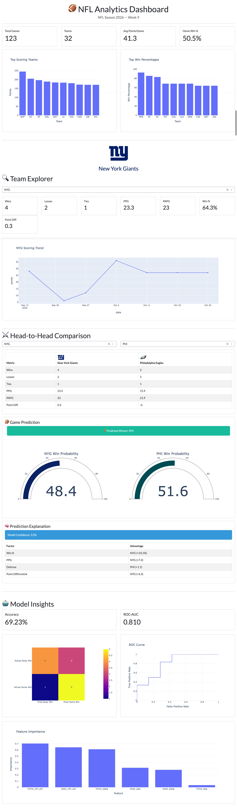

<div align="center">

# 🏈 NFL Predictor Dashboard

### Interactive NFL analytics, team comparisons, scoring trends, and game predictions

[](https://www.python.org/)
[](https://dash.plotly.com/)
[](https://www.postgresql.org/)
[](https://scikit-learn.org/)



</div>

## 📖 Overview

**NFL Predictor Dashboard** is an interactive Dash application for exploring NFL game data, comparing teams, visualizing performance, and generating win predictions from historical statistics.

The application loads completed games from the ESPN scoreboard API, stores them in PostgreSQL through SQLAlchemy, and uses a trained logistic regression model to estimate the probability that the home team will win.

## ✨ Features

- **League overview** — total games, team count, average points, and home-team win percentage
- **Top scoring teams** and **team win percentages**
- **32-team dropdowns** that remain available even during bye weeks
- **Team explorer** with wins, losses, ties, points scored, points allowed, and win percentage
- **Team scoring trends** with interactive Plotly charts
- **Head-to-head team comparison** with complete W-L-T records
- **Game prediction** showing both teams' estimated win probabilities
- **Model insights** including accuracy, ROC AUC, confusion matrix, ROC curve, and feature importance
- **NFL ties included** using NFL win-percentage rules: half a win for each tie

## 🧠 Machine Learning

The model uses six historical features:

- Home-team win percentage
- Away-team win percentage
- Home-team points per game
- Away-team points per game
- Home-team points allowed per game
- Away-team points allowed per game

Tie games are excluded from binary model training so they are not incorrectly treated as losses for the away team.

A trained model is stored at:

```text
app/ml/model.pkl
```

The dashboard safely displays placeholder values if the model is missing or needs retraining.

## 🛠️ Tech Stack

| Category         | Technology                                |
| ---------------- | ----------------------------------------- |
| Interface        | Dash, Dash Bootstrap Components, Plotly   |
| Data             | Pandas, NumPy                             |
| Database         | PostgreSQL, SQLAlchemy, psycopg2          |
| Machine Learning | scikit-learn, Logistic Regression, joblib |
| Data Source      | ESPN Scoreboard API                       |
| Environment      | Python, uv, python-dotenv                 |

## 🚀 Getting Started

### Prerequisites

- Python 3.15 or newer
- [`uv`](https://docs.astral.sh/uv/) installed
- A PostgreSQL database

### 1. Clone the repository

```bash
git clone https://github.com/Grizzly82/nfl-predictor-dashboard1.git
cd nfl-predictor-dashboard1
```

### 2. Install dependencies

```bash
uv sync
```

### 3. Configure PostgreSQL

Create a `.env` file in the project root:

```dotenv
DATABASE_URL=<your-postgresql-connection-url>
```

The application automatically converts a standard PostgreSQL URL to `postgresql+psycopg2://`.

### 4. Create and migrate database tables

```bash
uv run python app/database/create_tables.py
```

This creates the `games` table and adds/updates its season, week, external ID, and tie columns.

### 5. Ingest NFL games

```bash
uv run python app/services/ingest_games.py
```

### 6. Train the prediction model

```bash
uv run python app/ml/train_model.py
```

The command saves the model to `app/ml/model.pkl`.

### 7. Start the dashboard

```bash
uv run python app/dashboard/app.py
```

Open [http://127.0.0.1:8050](http://127.0.0.1:8050) in your browser.

## 📁 Project Structure

```text
app/
├── api/                 # Analytics API utilities
├── dashboard/           # Dash layout, callbacks, and app entry point
├── database/            # PostgreSQL connection, models, migration, repository
├── ml/                  # Training, prediction, metrics, and model storage
├── services/            # ESPN ingestion, analytics, transformations, team features
└── utils/               # NFL season and week helpers
screenshots/
└── Dashboard.jpeg       # Dashboard preview image
```

## 🔄 Typical Workflow

```bash
uv run python app/database/create_tables.py
uv run python app/services/ingest_games.py
uv run python app/ml/train_model.py
uv run python app/dashboard/app.py
```

## 🧪 Testing

Run the test suite with:

```bash
uv run pytest
```

You can also perform a syntax check across the application:

```bash
uv run python -m compileall -q app
```

## 📊 Notes

- Current-season and current-week information is retrieved from ESPN with a date-based fallback.
- Team selections are based on a canonical list of all 32 NFL teams and do not depend on database availability.
- Equal final scores are classified as ties.
- Model performance should improve as additional seasons and features are added.

# Project Metrics

| Category                   | Metric                  |
| -------------------------- | ----------------------- |
| NFL Teams Supported        | 32                      |
| Historical Games Processed | TBD                     |
| Seasons Ingested           | TBD                     |
| Database Tables            | 3+                      |
| Dashboard Charts           | 5+                      |
| Dashboard KPI Cards        | 10+                     |
| Engineered Features        | TBD                     |
| Machine Learning Models    | 1 (Logistic Regression) |
| Prediction Accuracy        | TBD                     |
| ROC-AUC Score              | TBD                     |
| API Source                 | ESPN NFL API            |
| Database                   | PostgreSQL              |
| Dashboard Framework        | Plotly Dash             |

## Results

The platform currently supports:

- 32 NFL teams
- PostgreSQL-backed analytics
- Automated ETL workflows
- Interactive team exploration
- Head-to-head team comparison
- Machine learning game prediction
- Model evaluation and diagnostics

Model Performance:

- Accuracy: 66.4%
- ROC-AUC: 0.713
- Features Engineered: 10
- Teams Supported: 32
- Dashboard Visualizations: 6

The application demonstrates the full analytics lifecycle from data ingestion through machine learning and visualization.

# Version 2

## Live Demo

https://nfl-analytics-dashboard.onrender.com

## Architecture

Neon PostgreSQL
↓
SQLAlchemy
↓
Analytics Layer
↓
Machine Learning
↓
Plotly Dash
↓
Render Deployment

## 👤 Author

Created by **Cris Vizcaino**.

## 📄 License

Add your preferred license here if you plan to distribute this project publicly.
